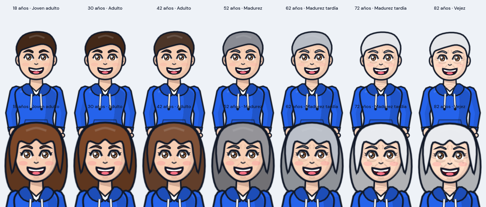

# Envejecimiento progresivo del personaje

Sistema visual que hace que el Sim aparente más años a medida que avanza la partida:
canas, arrugas, manchas, piel apagada, cejas más finas y una postura cada vez más
encorvada. Todo el cambio es **continuo y acumulativo** (curvas suaves por años),
nunca por saltos ni por etapas discretas.



## Cómo funciona

La edad no se guarda: se deduce del reloj de la partida con
`Variables_Estaticas.Calcular_Edad()` (18 años + semanas transcurridas). Cada
`Personaje_Visual` dibuja su retrato con la edad que le corresponde. La clínica
de `Tienda → Bienestar` puede restar años con
`Variables_Dinamicas.Rejuvenecimiento_Anios`, así que la edad efectiva es
`max(18, edad_natural − años_rejuvenecidos)` y todos los retratos se repintan
solos al cambiar:

- `edad = -1` (por defecto) → edad real de la partida.
- `edad = N` → fuerza una edad concreta (creador, capturas, pruebas).

El modelo puro vive en `Scripts/Logica/Personaje/Envejecimiento_Personaje.gd`
(`class_name` global, sin estado ni aleatoriedad):

```gdscript
var rasgos := Envejecimiento_Personaje.rasgos(edad)
# rasgos["canas"], rasgos["frente"], rasgos["surcos"], ...
```

Cada rasgo tiene su propia curva `[edad_inicio, edad_plenitud]` y avanza con
smoothstep. Dos Sims de la misma edad se ven exactamente igual.

## Curvas de progresión

| Rasgo | Inicio | Plenitud | Qué cambia |
|---|---:|---:|---|
| `surcos` | 29 | 68 | Surcos nasogenianos, pliegue del mentón, papada |
| `pelo_fino` | 30 | 84 | Menos brillo en el pelo (canas mate) |
| `frente` | 33 | 76 | Arrugas horizontales de frente y entrecejo |
| `canas` | 33 | 76 | Pelo y cejas del color original → gris → blanco |
| `patas_gallo` | 38 | 80 | Tres arrugas en la esquina exterior de cada ojo |
| `bolsas` | 41 | 82 | Bolsas y sombra bajo los ojos |
| `piel_apagada` | 44 | 92 | La piel pierde saturación y aclara muy poco |
| `flacidez` | 44 | 88 | Pliegues del cuello y sombra de papada |
| `cejas_finas` | 50 | 88 | Cejas progresivamente más finas |
| `manchas` | 52 | 90 | Manchas de la edad en mejillas y sienes |
| `postura` | 56 | 94 | Hombros caídos, cabeza hundida, balanceo más rígido |

A los 18 años todos los factores valen 0; a los 100 valen 1. Ej.: las primeras
canas aparecen hacia los 34–40, a los 55 el pelo está a medio encanecer y hacia
los 75 es blanco.

## Qué se dibuja en cada punto

`Envejecimiento_Personaje.dibujar_marcas_cara(...)` se llama dentro de
`_dibujar_cabeza_completa`, **después de la nariz y antes de la boca y el pelo**:

- Frente: 2 arrugas horizontales + 2 pliegues de entrecejo.
- Ojos: patas de gallo y bolsas con sombra suave.
- Nariz/boca: surcos nasogenianos.
- Mentón/cuello: pliegue del mentón, papada y 2 pliegues de cuello.
- Mejillas/sienes: manchas de la edad (elipses translúcidas).
- Ceja: grosor reducido con `cejas_finas`.
- Pelo: color mezclado con plata/blanco y brillo reducido.

La postura se aplica en `Personaje_Visual.obtener_rig_pose()`: los hombros bajan
hasta 1,4 px, la cabeza se hunde 1,7 px y el balanceo idle se amortigua. Con 18
años el rig es exactamente el original.

## Dónde se ve

Al vivir en `Personaje_Visual`, el envejecimiento aparece automáticamente en:

- El avatar de la cabecera (se repinta al cambiar de año aunque esté estático).
- El Perfil → Info y el resto de avatares de `Estilos_UI.avatar_personaje`.
- El escenario de actividad (`Escenario_Actividad`) en modo busto.
- El logo del menú y las viñetas de la intro si el Sim tiene edad avanzada.
- Cualquier retrato nuevo: no hay que registrar nada por pantalla.

Los retratos con `animar_idle = false` no se repintan por animación, pero su
`_process` compara la edad con la última pintada y hace `queue_redraw()` cuando
cambia (una comprobación de un entero por frame y nodo).

## Cómo ajustarlo

- Cambiar cuándo empieza/termina un rasgo: `Envejecimiento_Personaje.CURVAS`.
- Cambiar la intensidad del dibujo: opacidades y grosores en
  `dibujar_marcas_cara`.
- Ver la progresión sin jugar:

```bash
godot --path . --script res://Scripts/Otro/Herramientas/Exportar_Envejecimiento.gd
```

Genera `Funcionalidades/Personaje/Envejecimiento/Documentacion/Capturas/edades.png`
con hombres y mujeres de 18 a 82 años.

- Forzar una edad en una escena o captura:

```gdscript
var retrato := Personaje_Visual.new(apariencia, "retrato")
retrato.edad = 72
```

## Tests

`Funcionalidades/Personaje/Envejecimiento/Tests/test_envejecimiento.gd`
(adjuntar a un nodo en una escena vacía):

- Todos los factores a 0 con 18 años y a 1 con 100.
- Monotonía: ningún rasgo retrocede.
- Orden natural: surcos → canas → manchas → postura.
- Colores de pelo y piel válidos, progresivos y sin perder el tono.
- Límites de `etapa()` y porcentaje global.

## Archivos

| Archivo | Contenido |
|---|---|
| `Scripts/Logica/Personaje/Envejecimiento_Personaje.gd` | Curvas, colores y dibujo de las marcas de edad |
| `Scripts/GUI/Personaje/Personaje_Visual.gd` | Propiedad `edad`, postura y enganches de dibujo |
| `Scripts/Globales/Script_Principal.gd` | Fila «Etapa de vida» en Perfil → Info |
| `Scripts/Otro/Herramientas/Exportar_Envejecimiento.gd` | Lámina comparativa de edades |
| `Funcionalidades/Personaje/Envejecimiento/Tests/test_envejecimiento.gd` | Tests de la lógica pura |
